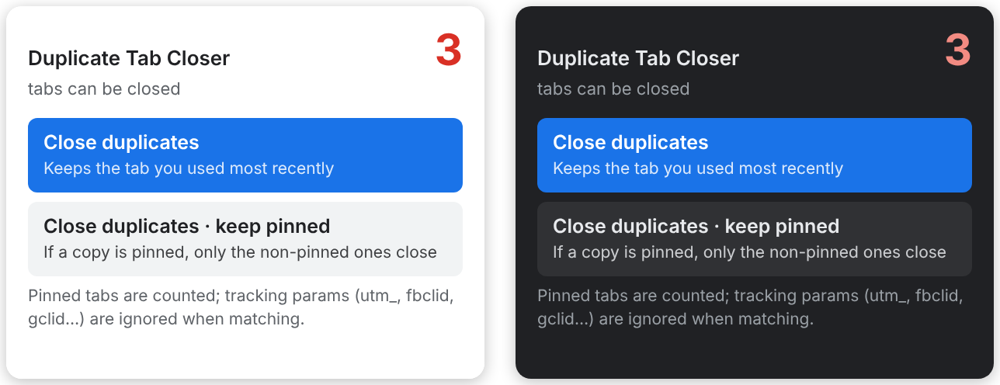

  

<h1 align="center">Duplicate Tab Closer</h1>

  A small browser extension that finds duplicate tabs and closes the older copies with one click.

  <a href="https://chromewebstore.google.com/detail/duplicate-tab-closer/kdbobogifbmlcflffffmkmjhfofomagj"><b>Get it for Chrome</b></a>
  &nbsp;·&nbsp;
  <a href="https://addons.mozilla.org/firefox/addon/dupe-tab-closer/"><b>Get it for Firefox</b></a>

  

## Features

- **Live count:** the toolbar icon shows how many duplicate tabs you have open.
- **Keeps the right tab:** closes older copies and keeps the one you used most recently.
- **Pinned-safe mode:** if a copy is pinned, only the non-pinned copies close.
- **Smart matching:** ignores things that don't change the page, like tracking codes (`utm_`, `fbclid`, `gclid`), `www.`, and `#` page anchors.
- **Light and dark mode:** follows your browser or system theme.
- **Private by design:** makes no network requests, has no analytics, and no data leaves your device. See the [privacy policy](PRIVACY.md).

## Browser support

Chrome, Brave, Opera, Edge and other Chromium browsers, plus Firefox 115 and newer.

## Install from this code

**Chrome, Brave, Opera or Edge:** open `chrome://extensions`, turn on Developer mode, press **Load unpacked** and pick this folder.

**Firefox:** open `about:debugging#/runtime/this-firefox`, press **Load Temporary Add-on** and pick `manifest.json`.

## License

[MIT](LICENSE)
